# VIJAY S
### Full Stack Developer | MERN Stack Developer

Building modern, responsive and scalable web applications.

---

<table>
<tr>
<td width="65%">

## 🟠 ABOUT ME

- 🎓 Final Year B.E Computer Science Engineering Student
- 💻 Interested in Full Stack Web Development
- 🚀 Building applications using the MERN Stack
- 🎨 Interested in UI/UX Design
- 🌱 Learning modern development technologies
- 🎯 Goal: Become a professional Software Developer

</td>
<td width="35%" align="center">

### DEVELOPER

**VIJAY S**

Full Stack Developer

📍 India

🌐 Open to Opportunities

</td>
</tr>
</table>

---

## 🟠 CORE EXPERTISE

| Frontend Development | Backend Development |
|:---|:---|
| React.js | Node.js |
| HTML5 & CSS3 | Express.js |
| JavaScript | REST APIs |
| Responsive Design | Authentication |

| Database | Other Skills |
|:---|:---|
| MongoDB | Git & GitHub |
| MySQL | UI/UX Design |
| Database Design | API Integration |

---

## 🟠 TECHNICAL SKILLS

**Languages & Technologies**

---

## 🟠 FEATURED PROJECTS

### 1. Personal Portfolio
A professional portfolio website showcasing my skills and projects.

[View Repository](https://github.com/vijaytech0067/myself)

### 2. Task Management Application
A task management application with authentication and task operations.

[View Repository](https://github.com/vijaytech0067/Task)

### 3. Medical Management System
A healthcare management project focused on digital hospital operations.

---

## 🟠 GITHUB STATISTICS

---

## 🟠 LET'S CONNECT

💬 Interested in collaboration, projects and opportunities.

**Thanks for visiting my GitHub profile!**

⭐ Feel free to explore my repositories.

<!--
**vijaytech0067/vijaytech0067** is a ✨ _special_ ✨ repository because its `README.md` (this file) appears on your GitHub profile.

Here are some ideas to get you started:

- 🔭 I’m currently working on ...
- 🌱 I’m currently learning ...
- 👯 I’m looking to collaborate on ...
- 🤔 I’m looking for help with ...
- 💬 Ask me about ...
- 📫 How to reach me: ...
- 😄 Pronouns: ...
- ⚡ Fun fact: ...
-->

